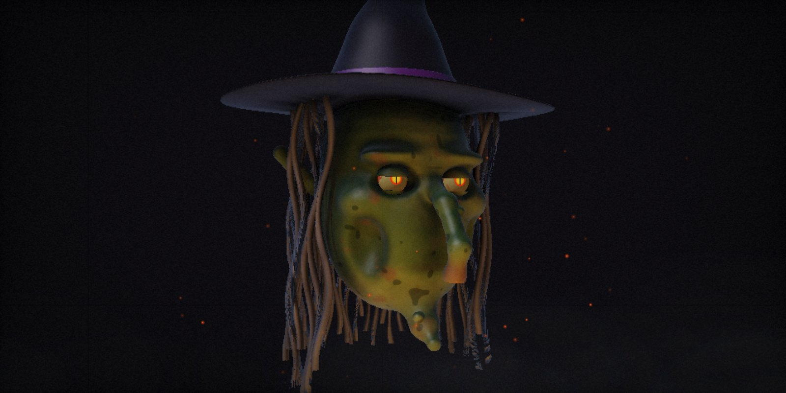

<p align="center">
  
</p>

<h1 align="center">Hauntface</h1>

<p align="center">
  <b>Your Halloween prop just woke up.</b><br>
  An open-source AI face that watches trick-or-treaters, answers them in character and scares on cue.<br>
  Hide any old monitor in a prop and it becomes a living, talking monster.
</p>

<p align="center">
  <a href="https://github.com/bartoszkolo/hauntface/releases/latest"></a>
  
  
</p>

| The Reaper (Kostucha) | The Witch (Baba Jaga) |
|---|---|
|  |  |

## What it does

- **A real-time 3D face.** The Reaper is a cracked skull in a black hood with fire burning in its eye sockets; the Witch has green warty skin, a long hooked nose and slit cat eyes that blink. Both are raymarched in a WebGL shader with real lights and shadows.
- **It listens and talks back.** Speech-to-text (Whisper), an LLM that stays in character (Claude, or a fast NVIDIA-hosted model), and a processed demonic or witchy voice with the jaw moving in sync. Polish and English.
- **It sees you.** With a webcam the head turns toward people, wakes up when someone approaches and dozes off when it's quiet. Frames are analysed on your computer at 64×48 pixels and never stored or sent anywhere.
- **It moves like an animatronic.** Servo-style head motion (with servo whine), breathing, blinking, nodding while it speaks.
- **It scares on cue.** Every scare has a hotkey, the monster triggers some on its own, and the AI can pick them mid-conversation.
- **Games.** Riddles for trick-or-treaters (right answer = candy) and a counter of "souls collected tonight".
- **Family mode.** Gentler prompt; no blood, screams, exorcist or possession.

## Download

| System | File |
|---|---|
| Windows | [Hauntface-win-x64.exe](https://github.com/bartoszkolo/hauntface/releases/latest/download/Hauntface-win-x64.exe) |
| macOS (Apple Silicon) | [Hauntface-mac-arm64.dmg](https://github.com/bartoszkolo/hauntface/releases/latest/download/Hauntface-mac-arm64.dmg) |
| Linux | [AppImage](https://github.com/bartoszkolo/hauntface/releases/latest/download/Hauntface-linux-x86_64.AppImage) · [.deb](https://github.com/bartoszkolo/hauntface/releases/latest/download/Hauntface-linux-amd64.deb) |

The builds are not code-signed yet, so your system will warn you:

- **Windows:** "Windows protected your PC" → **More info** → **Run anyway**.
- **macOS:** open the app once, then **System Settings → Privacy & Security → Open Anyway**.
- **Linux AppImage:** `chmod +x Hauntface-linux-x86_64.AppImage` and run it.

Intel Macs: run from source (below).

## Setting up your prop

1. Put a screen inside the prop: an old monitor or TV behind a hood or a mask works great. Add a webcam, a microphone and a speaker.
2. Start Hauntface, press **H** for settings and pick a monster and a language.
3. Give it a brain: paste an API key under **API keys**.
   - **NVIDIA** (default): get a free trial key at [build.nvidia.com](https://build.nvidia.com). The default model `nvidia/nemotron-3.5-lightning-30b-a3b` answers in 1–2 s. It's a trial with rate limits, not a production service.
   - **Anthropic Claude**: pay per use, a few cents per evening.
   - **OpenAI** key: needed for listening (Whisper) and for the best voice. Without it the monster uses your system's voice and can't hear.
4. Press **Test the brain**, then click the screen to wake the monster. **F** = fullscreen.

The first launch compiles the 3D shaders, which takes 10–20 s on weak integrated GPUs ("Summoning the spirit…"). After that it starts instantly.

For an unattended prop, run it in kiosk mode so it wakes up by itself: `Hauntface --kiosk --autostart`.

## Hotkeys

| Key | Effect | Key | Effect |
|---|---|---|---|
| **S** | lunge + scream + shattered screen | **P** | spiders crawl out of the eye sockets |
| **X** | exorcist head turn | **U** | ghosts in the fog |
| **L** | lightning + thunder | **N** | wolves howling |
| **G** | possession glitch | **V** | cracked screen |
| **B** | blood tears | **J** | bell tolls the hour |
| **T** | twitch | **C** | teeth chatter |
| **W** | whisper | **R** | laugh |
| **E** | eyes on/off | **Z** | sleep/wake |
| **H** | settings | **D** | debug line |
| **F** | fullscreen | **Space** | microphone on/off |
| **Esc** | stop talking | **K** | switch monster |
| **1–5** | eye fire colour | **A** | ambience on/off |

Type a line under "Speak manually" in the settings and the monster says it (puppeteer mode).

## Privacy

- Camera frames are analysed locally and thrown away.
- Microphone audio is recorded only while someone speaks, and sent only to the speech service you configured. Text goes only to the AI provider you picked. Nothing is stored except the night's visitor counter.
- In the desktop app, API keys are encrypted with your operating system's keychain and the page itself makes no network requests.
- If you set this up at your front door, it's polite to put up a small sign that the monster listens and watches.

## Run from source

Desktop app:

```bash
cd desktop
npm install
npm start
```

In a browser (needs a GPU with WebGL2):

```bash
python tools/serve.py
```

Then open http://127.0.0.1:8777/. The small server forwards NVIDIA requests, because NVIDIA's API doesn't accept calls straight from a browser.

Build installers: `cd desktop && npm run dist`. Releases are built by GitHub Actions when a `v*` tag is pushed.

## Project layout

```
app/        the face: index.html (shaders), app.js, i18n.js (PL/EN), providers-core.js (LLM/STT/TTS)
desktop/    Electron shell: main.js (keys, AI requests, window), preload.js, build/ (icons, signing)
site/       landing page; build.sh also copies app/ into /demo/
tools/      serve.py — run in a browser from source
```

## Roadmap

- [ ] Phone remote: type lines and fire scares from your phone
- [ ] ESP32 / Arduino bridge: real LED eyes, a jaw servo, a fog machine relay
- [ ] Offline mode: Ollama + whisper.cpp + Piper
- [ ] More monsters and community character packs

## License

MIT. Made for the night of 31 October by [bartoszkolo](https://github.com/bartoszkolo), the maker of [Stagelight](https://stagelight.cc).
